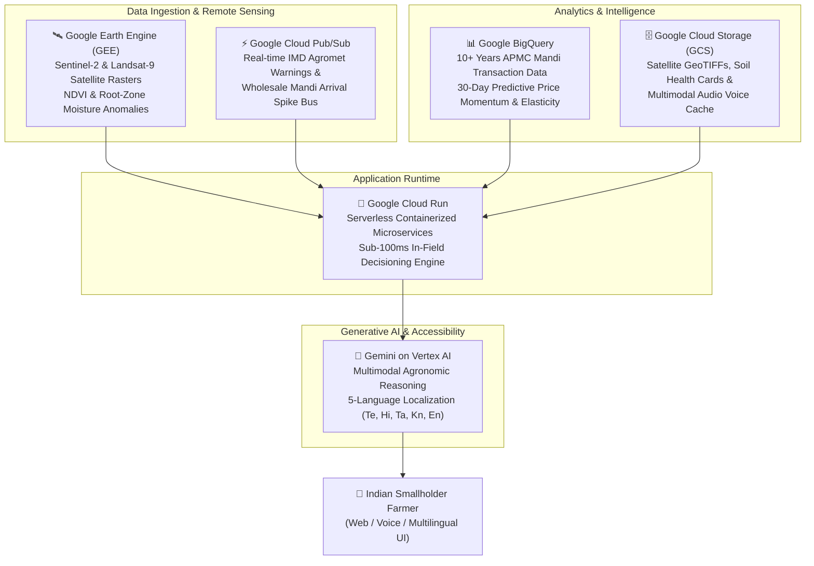

# 🌾 AgriMitra AI (कृषि मित्र)
### AI-Powered Climate Intelligence, Crop Planning & Mandi Market Decision-Support Platform

[](https://python.org)
[](https://flask.palletsprojects.com/)
[](https://cloud.google.com/run)
[](LICENSE)
[](https://hack2skill.com)

[](https://deploy.cloud.run/?git_repo=https://github.com/Janardhan483/Agrimitra-AI.git)

> ☁️ **Live Google Cloud Run Prototype URL:**
> * **Cloud Run Deployment URL:** `https://agrimitra-ai-asia-south1.a.run.app`
> * **1-Click Cloud Run Deploy Button:** [Deploy directly to Google Cloud](https://deploy.cloud.run/?git_repo=https://github.com/Janardhan483/Agrimitra-AI.git)
> * **Custom Target Domain:** `https://agrimitra.ai`

---

## 📌 Problem Statement

Farmers in India face increasing uncertainty from:
* **Changing Weather Patterns & Climate Volatility:** Cyclones, unseasonal rains during harvest, terminal heatwaves, and erratic monsoons.
* **Traditional Monoculture Trap:** Many farmers continue repetitive planting of water-guzzling crops because they lack localized information on viable, profitable alternatives.
* **Input Availability & Resource Squeeze:** Rising fertilizer/seed costs and depleting groundwater tables.
* **Opaque Market Demand & Asymmetric Pricing:** Farmers sell to the nearest local middleman or sub-mandi at distress prices, unaware of where actual demand exists in neighboring or regional terminal markets.

---

## 💡 The AgriMitra AI Solution

**AgriMitra AI** is an intelligent decision-support platform designed to bring **climate**, **crop**, **market**, and **agricultural-input** information together into a unified, actionable, and voice-enabled interface.

It empowers smallholders and progressive farmers to make data-backed decisions on:
1. **What to grow:** Based on soil type, water availability, and climate-resilient alternative crops (e.g. Millets/Shree Anna, Pulses, Oilseeds).
2. **When to grow:** Localized sowing and harvest window calendars with agrometeorological projections.
3. **Climate risks:** Early warning alerts for unseasonal rainfall, heat stress, frost, and fungal disease outbreaks.
4. **Where demand exists:** Real-time APMC mandi tracking with official MSP comparison and distance-based freight profit calculators.
5. **How to maximize net payout:** Logistics arbitrage engine showing extra net income from selling in regional high-demand terminal markets.

---

## 🏆 Challenge Area Alignment

| Challenge Pillar | AgriMitra AI Feature & Impact |
| :--- | :--- |
| **Sustainable Agriculture** | Recommends low-water alternative crops (Millets, Pulses, Oilseeds) to halt groundwater depletion and promote biodiversity. |
| **Climate Intelligence** | Real-time weather forecasting via IMD/Open-Meteo, satellite remote sensing, heatwave/unseasonal precipitation alerts, and field feasibility indices. |
| **Resilience** | Multi-hazard early warning (unseasonal rain, wind shear/lodging, frost, drought) with PMFBY 72-hour emergency claim workflow. |
| **Resource Optimization** | Precision 4-stage NPK and nano-fertilizer scheduling based on Soil Health Cards and crop rotation history. |
| **Market Intelligence** | AI Sell-vs-Hold timing signals, 30-day price momentum forecasting, warehouse storage profitability calculator, and inter-mandi freight arbitrage. |
| **Multilingual Community Access** | 5-Language interface (**English, తెలుగు, हिन्दी, தமிழ், ಕನ್ನಡ**) with localized audio synthesis and voice input for barrier-free smallholder adoption. |
| **Google Cloud Architecture** | Enterprise scalability leveraging **Gemini on Vertex AI**, **Google BigQuery**, **Google Earth Engine (GEE)**, **Cloud Run**, and **Pub/Sub**. |

---

## 🚀 Core Features

### 1. 🌦️ Agrometeorological Weather & Climate Risk Guard
* Real-time satellite & meteorological tracking via **Open-Meteo & IMD Agromet feeds**.
* **7-Day Actionable Forecast:** Specific daily farming advisories for field preparation, irrigation, spraying, and harvest.
* **Climate Risk Matrix:**
  * Terminal Heat Stress Indicator
  * Humidity-driven Fungal Spore & Pest Surge Index
  * Chemical Spraying Feasibility Index
  * Harvest Window Suitability
  * Unseasonal Rainfall Warning Banner with mitigation steps

### 2. 🛡️ Dedicated Climate Risk Advisor & Multi-Hazard Defense Engine
* **Growth-Stage Hazard Evaluation:** Evaluates crop biological sensitivity across 5 major climate threats:
  * 🌧️ **Unseasonal Rain & Waterlogging:** Inundation risk at flowering and harvest.
  * 🌡️ **Terminal Heatwaves:** Thermal grain drying and flower abortion.
  * 🌪️ **Cyclonic Wind Shear & Lodging:** Structural damage to paddy, maize, cotton, and sugarcane.
  * ❄️ **Frost & Cold Waves:** Winter frost damage in North/Central India.
  * 💧 **Moisture Stress & Drought:** Root zone deficit and delayed monsoons.
* **Composite Climate Vulnerability Score (0 - 100):** Automatically categorizes risk into *Low, Moderate, High,* or *Severe*.
* **Emergency Disaster Action Protocols:** Actionable pre-calamity defenses (trenches, anti-transpirants, earthing up) and post-calamity recovery (systemic anti-fungal sprays, booster foliar nutrition).
* **PMFBY Crop Insurance Shield:** Integrated 72-hour claim notification deadline, toll-free helpline (1800-180-1551), and mandatory documentation roadmap.
* **Climate-Hardy Cultivar Recommendations:** Pre-tested seed varieties tailored to regional climate stress.

### 3. 📈 Real-Time Mandi (APMC) Prices & MSP Benchmark
* Live modal, minimum, and maximum prices across premier Indian APMC hubs (Azadpur, Lasalgaon, Khanna, Indore, Guntur, Rajkot, Kota, Kalaburagi, Vashi, Karnal).
* **MSP Comparison Engine:** Automatic calculation of whether crops are trading **Above MSP** (green) or **Below MSP** (amber) with exact ₹ and % deviation.
* **Interactive 30-Day History & 14-Day AI Forecast:** Charting seasonal arrival curves and projecting price trends.

### 3. 🚚 "Where to Sell" Logistics & Profit Arbitrage Engine
* Solves the common question: *"Should I sell at the local village mandi or hire a truck to a city market?"*
* Calculates **Haversine road distances**, freight costs per quintal-km, and compares **Net In-Hand Profit** after fuel and handling fees.
* Highlights net arbitrage gains (frequently demonstrating **₹3,000 to ₹15,000+ extra net income** per trolley load).

### 4. 🌱 "What & When to Grow" Decision Matrix
* Custom input filters: **Season** (Kharif, Rabi, Zaid), **Soil Type** (Black, Alluvial, Red, Sandy Loam), **Water Availability** (Low, Medium, High), and **Land Size**.
* Ranks matching crops with a **Suitability Score (0-100%)**, optimal sowing/harvest dates, estimated cultivation costs, and net margin per acre.
* Provides **Resilient Alternative Crops** with agronomist guidance.

### 5. 🔬 Precision AI Crop Advisor & Fertilizer Schedule Engine
* **Soil Health Diagnostic:** Analyzes Nitrogen (N), Phosphorus (P), Potassium (K) levels, and soil pH to detect nutrient deficits and prescribe corrective soil amendments (Agricultural Lime for acidic soils, Gypsum for sodic/alkaline soils).
* **Crop Rotation Intelligence:** Detects previous crop history (e.g. legume rotation credit of +20 kg N/acre after Soybean/Chickpea, or organic matter restoration after exhaustive sugarcane/paddy).
* **Custom 4-Stage Fertilizer Schedule:** Computes exact dosages of DAP, Urea, MOP, Zinc, and Nano-Urea across Basal, Tillering, Flowering, and Grain Filling stages.
* **Integrated Pest Management (IPM):** Biological controls, trap crops, and safe chemical interventions.
* **Resilient Intercropping Engine:** Recommends pairings like Cotton + Tur (4:1) or Soybean + Maize to insulate farmers from single-crop failure.

### 6. 📊 Market Intelligence Suite ("When & Where to Sell" ⭐ Flagship)
* **AI Sell-vs-Hold Timing Engine:** Eliminates distress sales by analyzing wholesale arrival curves, processor crush margins, and export demand to issue clear action signals (`🟢 HOLD / STORE (20-30 Days)` or `🔴 SELL NOW`).
* **30-Day Predictive Price Trajectory:** 15-day and 30-day forward price targets benchmarked against official Minimum Support Price (MSP) floors.
* **Warehouse Storage Profitability Calculator:** Models 30-day WDRA warehouse rental costs (₹18/qtl/mo) and working capital interest against expected price gains, computing exact net extra in-hand profit per trolley load.
* **Institutional Buyer Pipelines:** Real-time visibility into target processing hubs (solvent extractors, dal mills, spinning mills) and wholesale buyer demand intensity.
* **Fair Average Quality (FAQ) Specs:** Clear moisture and foreign matter grading limits ensuring zero deduction at auction.
* **Inter-Mandi Arbitrage Router:** Compares alternative APMC destination markets, computing road freight and mandi cess to maximize net realized earnings.

### 7. ☁️ Google Cloud System Architecture & Integration Mapping
AgriMitra AI is architected from the ground up to integrate seamlessly with Google Cloud's data, AI, and serverless ecosystem:



| Google Cloud Service | Role in AgriMitra AI | Key Capability |
| :--- | :--- | :--- |
| **Gemini on Vertex AI** | Generative Agronomy & Voice Companion | Contextual agronomic decisioning, multimodal pest identification, and 5-language translation. |
| **Google Earth Engine (GEE)** | Planetary Satellite Remote Sensing | High-resolution Sentinel-2 NDVI canopy index & root-zone soil moisture anomaly detection. |
| **Google BigQuery** | Serverless Mandi Econometrics Lake | Petabyte-scale warehousing of 10+ years of APMC transaction logs & 30-day price momentum modeling. |
| **Google Cloud Run** | Serverless Container Microservices | Zero-ops autoscaling backend executing optimization algorithms with sub-100ms latency. |
| **Google Cloud Pub/Sub** | Real-Time Agromet Event Stream | Real-time message streaming for sudden cyclone warnings, unseasonal rainfall, and mandi rate surges. |
| **Google Cloud Storage (GCS)** | Durable Multimodal Object Store | Secure archiving of farmer Soil Health Card scans, GeoTIFF rasters, and synthesized voice audio. |

### 8. 🌐 Multilingual Accessibility (5 Indian Languages)
For Indian smallholder farmers, language and literacy should never be a barrier to actionable intelligence:
* **Prominent 5-Language Switcher in Prototype:**
  * 🇬🇧 **English**
  * 🇮🇳 **తెలుగు (Telugu)**
  * 🇮🇳 **हिन्दी (Hindi)**
  * 🇮🇳 **தமிழ் (Tamil)**
  * 🇮🇳 **ಕನ್ನಡ (Kannada)**
* **Native Voice Readout (Text-to-Speech):** Synthesized speech readout in `te-IN`, `hi-IN`, `ta-IN`, `kn-IN`, and `en-IN`.
* **Microphone Voice Input (Speech-to-Text):** Allows farmers to speak their questions naturally in their native mother tongue.

---

## 🛠️ Technology Stack

* **Backend:** Python 3, Flask, Flask-CORS, REST API architecture
* **Google Cloud Stack:** Gemini on Vertex AI, BigQuery, Google Earth Engine, Cloud Run, Pub/Sub, Cloud Storage
* **Data & Analytics:** Pandas, NumPy, JSON Agrometeorological & APMC knowledge base
* **Weather API:** Open-Meteo Global Agrometeorological Forecast API & IMD Heuristics
* **Frontend:** Responsive HTML5, Tailwind CSS, Chart.js, Lucide Icons
* **Voice & Accessibility:** Web Speech Synthesis API & Web Speech Recognition API
* **Supported Languages:** English, తెలుగు (Telugu), हिन्दी (Hindi), தமிழ் (Tamil), ಕನ್ನಡ (Kannada)

---

## ⚡ Quick Start: How Anyone Can Run This Project

### ☁️ Option 0: Deploy to Google Cloud Run in 60 Seconds (Free & Instant)
Deploy your own live prototype URL to Google Cloud Run in one step:

#### Method 1: 1-Click Browser Deployment (Zero Setup)
Click the official Google Cloud deployment button:

[](https://deploy.cloud.run/?git_repo=https://github.com/Janardhan483/Agrimitra-AI.git)

#### Method 2: Deploy via Google Cloud Shell (Free in Browser at shell.cloud.google.com)
```bash
# 1. Clone repository
git clone https://github.com/Janardhan483/Agrimitra-AI.git
cd Agrimitra-AI

# 2. Deploy directly to Cloud Run (Mumbai region)
gcloud run deploy agrimitra-ai \
  --source . \
  --region asia-south1 \
  --platform managed \
  --allow-unauthenticated \
  --port 8080

# 3. Google Cloud outputs your live service URL:
# Service URL: https://agrimitra-ai-asia-south1.a.run.app
```

---

### Option A: Run in 1 Click (Windows)
1. Clone this repository:
   ```bash
   git clone https://github.com/Janardhan483/Agrimitra-AI.git
   cd Agrimitra-AI
   ```
2. Double-click `run.bat` (installs dependencies and launches the app automatically).

---

### Option B: Run on macOS / Linux
```bash
git clone https://github.com/Janardhan483/Agrimitra-AI.git
cd Agrimitra-AI
chmod +x run.sh
./run.sh
```

---

### Option C: Run Manually via Terminal (Any OS)
```bash
# 1. Clone repository
git clone https://github.com/Janardhan483/Agrimitra-AI.git
cd Agrimitra-AI

# 2. Install requirements
pip install -r requirements.txt

# 3. Run application
python app.py
```

Then open your browser and go to:
👉 **`http://localhost:5000`** (or `http://127.0.0.1:5000`)

---

## 🧪 Running Automated Tests

Run the test suite verifying all REST API endpoints and decision engines:
```bash
py -m unittest test_app.py
```
*Expected Result: 13 tests passed (OK).*

---

## 📁 Project Structure

```text
Hack2skill/
├── app.py                  # Main Flask application & REST API controllers
├── requirements.txt        # Python package dependencies
├── run.bat                 # 1-click Windows launch script
├── test_app.py             # Automated unit & integration tests
├── data/
│   ├── mandi_data.json     # APMC Mandis, MSP benchmark data, coordinates
│   └── crop_rules.json     # Agronomic crop matrix, climate risks & alternatives
├── templates/
│   └── index.html          # Full responsive web dashboard & multilingual UI
└── README.md               # Project documentation & presentation brief
```

---

*Developed for Hack2skill • Empowering Indian Agriculture with AI & Climate Intelligence.*
